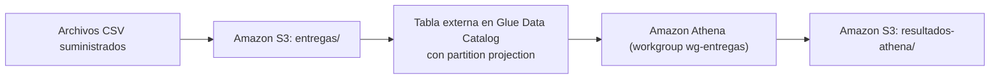

# Intentos de entrega con Athena y partition projection

Ejercicio de consulta de archivos diarios de intentos de entrega de una empresa de mensajería. Los CSV se guardan en Amazon S3, una tabla externa de AWS Glue Data Catalog los describe con **partition projection** por fecha y Amazon Athena los consulta sin crawlers ni registro manual de particiones.

## Arquitectura



- **S3**: un bucket privado con dos prefijos: `entregas/` para los datos y `resultados-athena/` para los resultados de las consultas.
- **Glue Data Catalog**: base de datos `mensajeria_entregas` y tabla externa `intentos_entrega`, con el esquema de los CSV y las reglas de proyección de la partición `fecha`.
- **Athena**: workgroup `wg-entregas`, que escribe los resultados en `resultados-athena/`.

Toda la infraestructura se define con Terraform en `infraestructura/`. La carga de archivos y las consultas se hacen con la AWS CLI.

## Estructura del repositorio

```text
.
├── README.md
├── .gitignore
├── infraestructura/        # Terraform: principal.tf, variables.tf, salidas.tf
├── consultas/              # SQL de la demostración inicial y del tercer día
├── resultados/
│   ├── inicial/            # Resultados de Athena con los días 1 y 2
│   └── final/              # Resultados de Athena con los días 1 a 3
├── evidencias/             # Salidas de Terraform, outputs e IDs de ejecución
├── respuestas.md           # Preguntas conceptuales
├── data/entregas/          # CSV suministrados (no se modifican)
└── resultados_esperados/   # Referencias suministradas (no se suben a S3)
```

## Prerrequisitos

| Herramienta | Versión usada / mínima |
| --- | --- |
| Terraform | >= 1.5 |
| Proveedor AWS de Terraform | >= 5.0 |
| AWS CLI | v2 |
| Shell | bash o zsh (los comandos usan `tee`, `tr` y `diff`) |

**Credenciales.** Un usuario IAM configurado en la AWS CLI (`aws configure` o un perfil con `AWS_PROFILE`). Para comprobar la identidad activa:

```bash
aws sts get-caller-identity
```

**Permisos IAM necesarios** para el usuario que despliega y consulta:

- S3: crear, configurar y eliminar el bucket; `s3:PutObject`, `s3:GetObject`, `s3:ListBucket`, `s3:DeleteObject`.
- Glue: `glue:CreateDatabase`, `glue:CreateTable`, `glue:GetDatabase`, `glue:GetTable`, `glue:GetPartitions`, `glue:UpdateTable`, `glue:DeleteTable`, `glue:DeleteDatabase`.
- Athena: `athena:CreateWorkGroup`, `athena:GetWorkGroup`, `athena:UpdateWorkGroup`, `athena:DeleteWorkGroup`, `athena:ListWorkGroups`, `athena:TagResource`, `athena:UntagResource`, `athena:ListTagsForResource`, `athena:StartQueryExecution`, `athena:GetQueryExecution`, `athena:GetQueryResults`, `athena:StopQueryExecution`.

> Durante el ejercicio, el primer `terraform apply` creó todo excepto el workgroup porque faltaba `athena:CreateWorkGroup`. Se agregó una política en línea con los permisos de Athena al usuario y un segundo `apply` creó solo el recurso pendiente.

## Configuración

| Parámetro | Valor | Dónde se define |
| --- | --- | --- |
| Región | `us-east-1` | `variables.tf` (`region`) |
| Bucket | `de-final-entregas-aws` | `terraform.tfvars` o `-var` (`nombre_bucket`, sin valor por defecto) |
| Base de datos Glue | `mensajeria_entregas` | `variables.tf` |
| Tabla | `intentos_entrega` | `variables.tf` |
| Workgroup de Athena | `wg-entregas` | `variables.tf` |
| Rango proyectado | `2026-10-01` a `2026-10-03` | `variables.tf` |

El nombre del bucket debe ser único a nivel global y estar en minúsculas. Para no repetirlo en cada comando se crea `infraestructura/terraform.tfvars`, que **no se sube al repositorio** (está en `.gitignore`):

```hcl
nombre_bucket = "de-final-entregas-aws"
```

Si ese nombre ya existe en otra cuenta, se debe elegir otro (por ejemplo, con un sufijo propio) y usarlo en todos los pasos.

### Tabla externa y partition projection

La tabla `intentos_entrega` declara:

- Las cinco columnas del CSV en orden: `id_envio string`, `ciudad string`, `transportadora string`, `estado string`, `duracion_minutos int`.
- `LazySimpleSerDe` con `field.delim = ","` y `skip.header.line.count = 1` para omitir el encabezado.
- `fecha` como clave de partición de tipo `string`, fuera de las columnas del archivo.
- Las propiedades de proyección:

| Propiedad | Valor |
| --- | --- |
| `projection.enabled` | `true` |
| `projection.fecha.type` | `date` |
| `projection.fecha.format` | `yyyy-MM-dd` |
| `projection.fecha.range` | `2026-10-01,2026-10-03` |
| `projection.fecha.interval` | `1` |
| `projection.fecha.interval.unit` | `DAYS` |
| `storage.location.template` | `s3://<bucket>/entregas/fecha=${fecha}/` |

En Terraform la plantilla se escribe con `$${fecha}` para que el valor llegue literal a Glue. La plantilla termina en `/` porque apunta al prefijo de la partición; el archivo `entregas.csv` está dentro de ese prefijo.

## 1. Despliegue

Desde la raíz del repositorio:

```bash
cd infraestructura
terraform init
terraform validate
terraform plan
terraform apply -no-color 2>&1 | tee ../evidencias/aplicacion_terraform.txt
terraform output -json > ../evidencias/outputs.json
cd ..
```

`2>&1` es necesario para que los errores, que Terraform escribe en stderr, también queden en la evidencia.

Comprobaciones:

```bash
terraform -chdir=infraestructura state list   # 7 recursos
aws athena list-work-groups --region us-east-1 --query "WorkGroups[].Name"   # incluye wg-entregas
```

Evidencias generadas: `evidencias/aplicacion_terraform.txt` y `evidencias/outputs.json`.

## 2. Variables de shell y función de ejecución

Estas variables se definen en cada terminal nueva, desde la raíz del repositorio:

```bash
REGION=$(terraform -chdir=infraestructura output -raw region)
BUCKET=$(terraform -chdir=infraestructura output -raw bucket_nombre)
WG=$(terraform -chdir=infraestructura output -raw athena_workgroup)
echo "$REGION $BUCKET $WG"
```

La siguiente función ejecuta una consulta en el workgroup, espera a que termine, descarga el CSV que Athena escribe en `resultados-athena/<id>.csv`, quita las comillas dobles que Athena agrega a cada valor y registra la ejecución en `evidencias/ejecuciones_athena.csv`:

```bash
ejecutar_consulta () {
  # Uso: ejecutar_consulta <archivo_sql> <etapa> <archivo_resultado> [texto_sql]
  local sql="$1" etapa="$2" salida="$3" texto="${4:-$(cat "$1")}"
  local id estado
  id=$(aws athena start-query-execution --region "$REGION" --work-group "$WG" \
        --query-string "$texto" --query QueryExecutionId --output text) || return 1
  while true; do
    estado=$(aws athena get-query-execution --region "$REGION" --query-execution-id "$id" \
              --query QueryExecution.Status.State --output text)
    [ "$estado" = "SUCCEEDED" ] && break
    if [ "$estado" = "FAILED" ] || [ "$estado" = "CANCELLED" ]; then
      aws athena get-query-execution --region "$REGION" --query-execution-id "$id" \
        --query QueryExecution.Status.StateChangeReason --output text
      return 1
    fi
    sleep 2
  done
  mkdir -p "$(dirname "$salida")"
  aws s3 cp "s3://$BUCKET/resultados-athena/$id.csv" - --region "$REGION" | tr -d '"' > "$salida"
  echo "$etapa,$sql,$id,$salida" >> evidencias/ejecuciones_athena.csv
  echo "$id -> $salida"
}
```

Quitar las comillas es seguro porque, según el enunciado, ningún valor contiene comas, comillas ni saltos de línea. Así el formato coincide con `resultados_esperados/`.

El registro de ejecuciones se inicializa una sola vez, antes de la primera consulta:

```bash
echo "etapa,archivo_sql,id_ejecucion,archivo_resultado" > evidencias/ejecuciones_athena.csv
```

Las consultas también pueden ejecutarse en la consola de Athena. En ese caso se debe seleccionar el workgroup `wg-entregas` (no `primary`) y la región `us-east-1`, descargar el resultado y anotar el ID de ejecución a mano.

## 3. Demostración inicial: días 1 y 2

### 3.1 Carga

Los archivos se suben uno por uno. No se usa `--recursive` ni `sync`, y el día 3 se queda en local:

```bash
aws s3 cp "data/entregas/fecha=2026-10-01/entregas.csv" \
  "s3://$BUCKET/entregas/fecha=2026-10-01/entregas.csv"

aws s3 cp "data/entregas/fecha=2026-10-02/entregas.csv" \
  "s3://$BUCKET/entregas/fecha=2026-10-02/entregas.csv"

aws s3 ls "s3://$BUCKET/entregas/" --recursive   # solo deben aparecer los días 1 y 2
```

Comprobación previa (no se registra como evidencia): `SELECT COUNT(*) FROM mensajeria_entregas.intentos_entrega` devuelve **12**.

### 3.2 Consultas

| Archivo | Qué calcula |
| --- | --- |
| `consultas/intentos_por_fecha_estado.sql` | Intentos por fecha y estado, ordenados por fecha y estado. |
| `consultas/porcentaje_exito_por_fecha_ciudad.sql` | `100 × entregas exitosas / total de intentos` por fecha y ciudad, con dos decimales. El denominador incluye todos los estados y `100.0` evita la división entera. |
| `consultas/duracion_promedio_2026-10-02.sql` | Promedio de duración del 2 de octubre solo con estado `entregado`, con dos decimales. |

Las dos primeras filtran `fecha BETWEEN '2026-10-01' AND '2026-10-03'`, todo el rango proyectado, para que el mismo SQL sirva en ambas etapas. Los decimales se fijan con `CAST(... AS DECIMAL(..., 2))`, que redondea y conserva siempre dos cifras (por ejemplo, `50.00`).

### 3.3 Ejecución

```bash
ejecutar_consulta consultas/intentos_por_fecha_estado.sql inicial \
  resultados/inicial/intentos_por_fecha_estado.csv

ejecutar_consulta consultas/porcentaje_exito_por_fecha_ciudad.sql inicial \
  resultados/inicial/porcentaje_exito_por_fecha_ciudad.csv

ejecutar_consulta consultas/duracion_promedio_2026-10-02.sql inicial \
  resultados/inicial/duracion_promedio_2026-10-02.csv
```

### 3.4 Comparación con las referencias

```bash
diff resultados/inicial/intentos_por_fecha_estado.csv \
     resultados_esperados/intentos_por_fecha_estado_inicial.csv

diff resultados/inicial/porcentaje_exito_por_fecha_ciudad.csv \
     resultados_esperados/porcentaje_exito_por_fecha_ciudad_inicial.csv

diff resultados/inicial/duracion_promedio_2026-10-02.csv \
     resultados_esperados/duracion_promedio_2026-10-02.csv
```

`diff` sin salida indica que el resultado coincide. Filas esperadas: 6, 4 y 1.

## 4. Demostración de una nueva fecha: día 3

### 4.1 Carga

Sin modificar la infraestructura ni la tabla (no se ejecuta `terraform apply`):

```bash
aws s3 cp "data/entregas/fecha=2026-10-03/entregas.csv" \
  "s3://$BUCKET/entregas/fecha=2026-10-03/entregas.csv"
```

Durante esta etapa **no** se ejecutan crawlers, `MSCK REPAIR TABLE` ni `ALTER TABLE ADD PARTITION`, no se crean particiones en Terraform y no se cambia el rango ni otra propiedad de la tabla. El día 3 queda disponible solo por subir el archivo, porque `2026-10-03` ya estaba dentro del rango proyectado desde el despliegue inicial.

### 4.2 Verificación del tercer día

`consultas/verificacion_tercer_dia.sql` contiene tres sentencias. Athena ejecuta una por ejecución, así que cada bloque se corre por separado. Todas se registran con el mismo `archivo_sql`:

```bash
V=consultas/verificacion_tercer_dia.sql

ejecutar_consulta "$V" final resultados/final/verificacion_tercer_dia.csv \
  "SELECT fecha, id_envio, ciudad, transportadora, estado, duracion_minutos
   FROM mensajeria_entregas.intentos_entrega
   WHERE fecha = '2026-10-03' ORDER BY id_envio ASC"

ejecutar_consulta "$V" final resultados/final/verificacion_total_registros.csv \
  "SELECT COUNT(*) AS total_registros,
          COUNT_IF(fecha = '2026-10-01') AS registros_2026_10_01,
          COUNT_IF(fecha = '2026-10-02') AS registros_2026_10_02,
          COUNT_IF(fecha = '2026-10-03') AS registros_2026_10_03
   FROM mensajeria_entregas.intentos_entrega
   WHERE fecha BETWEEN '2026-10-01' AND '2026-10-03'"

ejecutar_consulta "$V" final resultados/final/verificacion_conteo_estados_tercer_dia.csv \
  "SELECT fecha, estado, COUNT(*) AS total_intentos
   FROM mensajeria_entregas.intentos_entrega
   WHERE fecha = '2026-10-03' GROUP BY fecha, estado ORDER BY estado ASC"
```

Criterios de verificación:

- `verificacion_tercer_dia.csv`: 6 registros, los mismos de `data/entregas/fecha=2026-10-03/entregas.csv` más la columna `fecha`.
- `verificacion_total_registros.csv`: `total_registros = 18`, con 6 registros por fecha.
- `verificacion_conteo_estados_tercer_dia.csv`: coincide con las filas de `2026-10-03` de `resultados_esperados/intentos_por_fecha_estado_final.csv`.

### 4.3 Consultas agregadas sobre los tres días

Se ejecutan los mismos archivos SQL de la etapa inicial, sin cambios:

```bash
ejecutar_consulta consultas/intentos_por_fecha_estado.sql final \
  resultados/final/intentos_por_fecha_estado.csv

ejecutar_consulta consultas/porcentaje_exito_por_fecha_ciudad.sql final \
  resultados/final/porcentaje_exito_por_fecha_ciudad.csv

diff resultados/final/intentos_por_fecha_estado.csv \
     resultados_esperados/intentos_por_fecha_estado_final.csv

diff resultados/final/porcentaje_exito_por_fecha_ciudad.csv \
     resultados_esperados/porcentaje_exito_por_fecha_ciudad_final.csv
```

Filas esperadas: 9 y 6. La duración promedio sigue correspondiendo al día 2 y no se vuelve a ejecutar.

## 5. Evidencias

| Archivo | Contenido |
| --- | --- |
| `evidencias/aplicacion_terraform.txt` | Salida completa de `terraform apply`. |
| `evidencias/outputs.json` | Outputs: bucket, base de datos, tabla, workgroup, rango y ubicaciones. |
| `evidencias/ejecuciones_athena.csv` | Cada ejecución con `etapa`, `archivo_sql`, `id_ejecucion` y `archivo_resultado`. |
| `evidencias/eliminacion_terraform.txt` | Salida completa de `terraform destroy`. |
| `resultados/inicial/` y `resultados/final/` | Resultados descargados de Athena por etapa. |

Las respuestas conceptuales están en [`respuestas.md`](respuestas.md).

## 6. Limpieza

Primero se guardan y se suben al repositorio todas las evidencias y resultados. Después:

```bash
# Opcional: el bucket tiene force_destroy, pero así queda explícito
aws s3 rm "s3://$BUCKET" --recursive

cd infraestructura
terraform destroy -no-color 2>&1 | tee ../evidencias/eliminacion_terraform.txt
cd ..
```

La eliminación borra el bucket (con los datos de `entregas/` y los resultados de `resultados-athena/`), la tabla, la base de datos de Glue y el workgroup (con `force_destroy`, que incluye su historial). Para confirmar:

```bash
terraform -chdir=infraestructura state list   # sin salida
aws athena list-work-groups --region us-east-1 --query "WorkGroups[].Name"   # sin wg-entregas
```

La política IAM agregada manualmente al usuario no forma parte de los recursos del ejercicio. Se puede retirar desde la consola de IAM si ya no se necesita.

## Seguridad

- No se publican credenciales ni archivos de estado. `.gitignore` excluye `.terraform/`, `*.tfstate`, `*.tfstate.*`, `*.tfvars`, `.env` y archivos de credenciales.
- El bucket es privado: bloqueo total de acceso público, propiedad de objetos forzada al dueño y cifrado SSE-S3. Los resultados de Athena también se cifran con SSE-S3.